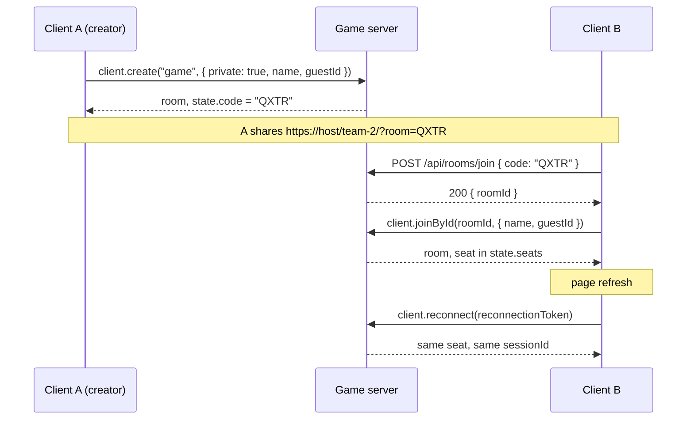

# Lobby and join flow

How a player creates a room, joins it by code or invite link, holds a seat and comes back after a refresh. This is the design of the previous hackathon's platform (`sdm2026-1`), written down as the reference for `@sdm/host`, `@sdm/core` and the template game here. Four games ran on it.

It is a description of the target, not of code that exists yet: the packages are built in the order in [../README.md](../README.md#build-order), and [What the platform team builds](#what-the-platform-team-builds) maps each part to a step. Where the previous platform made a choice, this document says so and gives the reason.

Source: the previous platform's code and docs, kept in this repository's history at commit `2f1cd69` (`server/host/src/gameRoom.ts`, `server/host/src/routes.ts`, `server/core/src/server/roomCodes.ts`, `server/core/src/shared/guest.ts`, `server/core/src/client/urlParams.ts`, `server/docs/CLIENT_GUIDE.md`, `server/docs/design-docs/room-base.md`).

## The flow at a glance



Rooms live in one server process per game, so the code lookup is a plain in-memory map and needs no matchmaker query.

## Room codes

- A code is **4 letters from `ABCDEFGHJKLMNPQRSTUVWXYZ`**: A to Z without `I` and `O`, so a code cannot be misread as `1` or `0`.
- Codes are **unique among the live rooms of the process**. The room picks a random code and retries when it is taken, up to 100 attempts, then fails.
- The code is chosen **outside the simulation**, before the simulation starts, because it is part of the state and of the replay. It is therefore allowed to use real randomness (`Math.random()` is acceptable here, and nowhere inside game rules).
- The code is published in `state.code` (from `BaseState`) and in the room metadata. Quick-match rooms have no code: `state.code` is `""`.
- Lookups are **case-insensitive and trim whitespace**; the server compares upper case.
- The client accepts exactly the letters the server issues: `^[A-HJ-NP-Z]{4}$`, through `normalizeRoomCode()`. A test keeps the client pattern and the server alphabet in sync. An invalid code in a link becomes `null` on the client, so the player gets an instant error instead of "unknown room".

## Creating a private room

```ts
const room = await client.create("game", { private: true, name: "Ada", guestId: getGuestId() });
// room.state.code is "QXTR"
```

- `private: true` in the create options makes the room private. The room generates a code, stores it in its metadata, and calls `setPrivate(true)`, which hides it from quick match.
- Without `private: true` the room is a quick-match room: `client.joinOrCreate("game", options)` finds it and `state.code` is `""`.
- The room reads only the `private` flag from the create options. The creator's options also hold the raw guest id, so the room never logs or stores the options object as a whole (see [Guest id](#guest-id)).
- The room registers itself in an in-memory **live room registry** (by room id and by code) when it is created, and removes itself when it is disposed.

Colyseus excludes private rooms from matchmaking queries, so looking a private room up with `filterBy(["code"])` does not work. That is why the join goes through the registry and an HTTP route.

## Joining by code

Two calls: an HTTP route turns the code into a room id, then the SDK joins by id.

```ts
const res = await fetch(`${SERVER_URL}/api/rooms/join`, {
  method: "POST",
  headers: { "content-type": "application/json" },
  body: JSON.stringify({ code }),
});
const { roomId } = await res.json();
const room = await client.joinById(roomId, { name: "Bo", guestId: getGuestId() });
```

`POST /api/rooms/join` (body `{ code }`, at most 1 KB):

| Answer | When | Body |
|---|---|---|
| `200` | The code belongs to a live room with a free seat | `{ roomId }` |
| `400` | The body is not `{ code: string }` | `{ error: "expected { code }" }` |
| `404` | No live room has this code, or the code is empty | `{ error: "unknown room" }` |
| `409` | The room has as many players as `maxPlayers` | `{ error: "room is full" }` |

Notes:

- The route only checks that a seat looks free. The seat is taken by the later `joinById`, so two players can race for the last seat: the second `joinById` is rejected by Colyseus (`maxClients` is `maxPlayers`) and the client shows that error.
- `joinById` checks the join options with the game's `joinOptionsSchema`. A rejected join returns `can't join: <reason>` to the client. A game error during join closes the room instead (`can't join: the room hit an error and closed`).
- The client reads `error` from the JSON body and shows it. The route stays on in production.
- Do not put room ids or codes in production stats: `GET /api/stats` leaves them out there, because they would let anyone join private rooms or download their replays.

## Invite links

An invite link is the game's own page with `?room=CODE`:

```
https://host/team-2/?room=QXTR
```

- `buildInviteLink(location.href, code)` builds it: the current page with the query and hash replaced by `?room=<code>`.
- `readClientParams(location.search).room` reads it back, already normalised.
- State goes in the **query string, never in the path**. Behind the gateway the game sits under `/team-N/`, and a path such as `/lobby/QXTR` would load `index.html` with its relative assets resolving under `/lobby/`.
- On page load the client tries, in this order: **reconnect** with a saved token, **join by the `?room=` code**, **show the lobby** (create room, or type a code).
- `?name=` pre-fills the player name (kept to 24 characters).

## Seats

`BaseState.seats` is a map keyed by `sessionId`, written only by the room, never by the game:

| Field | Meaning |
|---|---|
| `connected` | `true` while the player's connection is up |
| `lastSeq` | The last input sequence number the server applied for this player |
| `guest` | The player's public fingerprint for this game, or `""` (see [Guest id](#guest-id)) |

- `maxPlayers` from the game's config sets `maxClients`; a full room answers `409` on the join route.
- A seat is created on join and freed on `leave`. The game may **read** `seats` inside the simulation, which is deterministic because every seat change is recorded in the replay.
- The game keeps its own entities (a player map, one shared vehicle) wherever it likes. The platform does not assume one entity per player.
- Optional game hooks `disconnect(ctx, playerId)` and `reconnect(ctx, playerId)` let the game react, for example a shared vehicle losing its driver.

## Reconnection

| Event | What the room does |
|---|---|
| Unexpected drop (tab closed, network lost) | `connected` becomes `false`, the seat and the player's state stay, and the room holds the seat for `reconnectSeconds` |
| Player returns within the window | Same `sessionId`, same state, `connected` is `true` again |
| Window expires | The room records a `leave` and the seat is gone |
| Consented leave (the player pressed leave) | The seat is freed at once, with no waiting window |

- `reconnectSeconds` comes from the game's `config/game.json` (the template used 20). `0` turns the hold off.
- The client saves `room.reconnectionToken` in **`sessionStorage`** and calls `client.reconnect(token)` after a refresh. Wrap `sessionStorage` in `try/catch`: it throws in private windows.
- If `reconnect` throws (the seat expired or the room closed), the client clears the token and **joins the saved room code as a new player**.
- **Sequence reset:** on reconnect the server resets that seat's sequence, so the next input is accepted whatever its `seq`. A refreshed client can start again at `seq` 0 and does not need to remember it.
- **Replays:** `drop` and `reconnect` are recorded as events, and a `leave` is recorded at the tick the window expires, so a replay re-runs to the same state hash.
- Storage keys include the game's path (`sdm:${pathname}:reconnectionToken`). All games share one address behind the gateway, so a token saved by `/team-2/` must never be tried on `/team-4/`.

## Guest id

A `sessionId` lasts one seat. To know that the same person is back (a second tab, a reload, after the seat expired), the browser sends a guest id on every create and join.

- **Client:** `getGuestId()` keeps a random UUID in `localStorage` under `sdm:guestId` and sends it as the join option `guestId`. One key for the whole browser, shared by every game on the address. Without usable storage it returns one in-memory id for the page, so the player still joins but is not recognised after a reload.
- **Server:** the room replaces the raw id with a public **fingerprint**: the first 12 hex characters of `SHA-256("<gameId>:<lowercased id>")`. Anything that is not a UUID gives `""` and **never rejects the join**.
- The raw id is removed from the options **before** the game's `joinOptionsSchema` sees them, so games do not declare it and a strict schema cannot reject it.
- The fingerprint is stored in `seats[sessionId].guest` (synced), passed to the game's `join` as `info.guest`, recorded in the replay's join event, and written in the `player joined` log line.
- The fingerprint includes the game id, so one browser has a different `guest` in each game: players cannot be linked across games.
- The raw id is never put in state, logs, replays or HTTP responses, because those can be downloaded.

The guest id is a **hint, not a login**. Use it to recognise a returning player in this game (for example to give back their character). Never use it to hand over a seat, a score or ownership: every game on the address can read `sdm:guestId`, and a client can send any UUID, including a fresh one.

Not included: accounts, keeping anything across server restarts, and stopping one guest from holding two seats (two tabs). A game that cares compares `guest` values itself.

## The waiting room and "ready" belong to each game

The platform gives a room, seats, a code, reconnection and a guest id. It has **no lobby phase, no ready flag and no start button**: those differ from game to game, so each game builds them in its own `shared/` rules and client.

The patterns below use only what the platform provides. They are the recommended shape for a game's waiting room; check them against the previous four games before treating them as fixed.

- **Phase in the game state.** A synced field such as `phase: "lobby" | "playing" | "finished"`. `step` does nothing game-related while the phase is `lobby`.
- **Ready per player.** A boolean on the player entity, set by an input such as `{ type: "ready", value: true }`. It lives in game state, not in `seats`, because `seats` is owned by the room.
- **Who starts.** Either everyone ready (and at least a minimum number of players), or a host. The host is the first player to join, stored as a `hostId` in the game state, and handed to the next player in `leave` and `disconnect` when the host goes.
- **Start is a state change inside `step`.** `step` sees the inputs and the seats, flips `phase` to `playing` and seeds the match with `ctx.rng`. Nothing happens outside the tick, so replays reproduce it.
- **Late joiners.** The game decides: join as spectator, wait for the next round, or take a free slot. `maxPlayers` caps the room either way.
- **Returning players.** Keep what you want to restore (a character, a team, a ready flag) in synced state keyed by `guest`, so a player whose seat expired gets it back in `join`. Keep it in state, not in a variable, so replays reproduce it.
- **Test it with debug commands.** A game command such as `start` or `ready all` lets QA reach the playing phase without two browsers. Debug commands are recorded in replays and rejected in production.
- **The waiting-room UI is the game's client.** The template shows only the minimum: a create button, a code field, a join button and the invite link in the HUD.

Rules that still apply to all of it: randomness only from `ctx.rng`, time only from `ctx.tick` and `ctx.dt`, and `shared/` stays browser-safe.

## What the platform team builds

In the build order of [../README.md](../README.md#build-order). The lobby and join flow needs these parts:

| Step | Package | What this flow needs from it |
|---|---|---|
| 3 | `@sdm/core/shared` | `Routes.joinByCode` (`/api/rooms/join`), `JoinByCodeRequestSchema` and `JoinByCodeResponseSchema`, the `guestId` option name, the guest fingerprint pattern and `isGuestId()`, and the replay events `drop` and `reconnect` |
| 3 | `@sdm/core/sim` | `BaseState` with `tick`, `code`, `paused`, `seats`, and `Seat` with `connected`, `lastSeq` and `guest`; `RoomSettingsSchema` with `maxPlayers` and `reconnectSeconds`; the `join` hook receiving `info.guest`; the optional `disconnect` and `reconnect` hooks |
| 4 | `@sdm/core/server` and `@sdm/host` | `generateRoomCode()`; `guestFingerprint()` and `withoutGuestId()`; the live room registry; `createGameRoom()` with private rooms, `setPrivate(true)`, `allowReconnection()` in `onDrop`, `onReconnect`, seat expiry and the sequence reset; `POST /api/rooms/join` with the `400`, `404` and `409` answers; a stats route that hides ids and codes in production |
| 5 | `@sdm/template` | A minimal lobby: create a private room, join by code, show the invite link, reconnect with the saved token, fall back to the saved code, and keys scoped by game path |
| 6 | Gateway | Games under `/team-N/`, so invite links and storage keys must work behind a path prefix |
| 7 | `@sdm/core/client` | `getGuestId()`, `normalizeRoomCode()`, `readClientParams()`, `buildInviteLink()` and `serverUrlFromPage()` |

The code alphabet, the room code length and the client code pattern must be defined once and tested together, so the client never accepts a code the server cannot issue.

## Not part of this flow

- Accounts and login.
- Matchmaking beyond quick match and join by code.
- Keeping rooms, seats or replays across a server restart or deploy.
- Several server processes for one game: the code lookup is in-process, so it would need a shared registry first.
